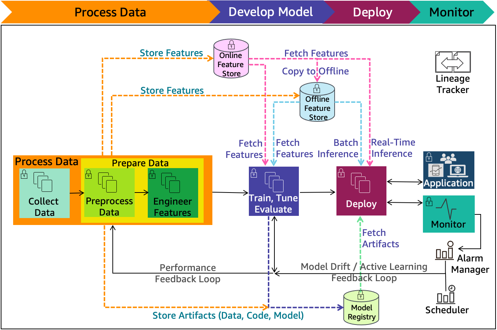

# Infraestrutura de Machine Learning

Esta seção descreve os componentes de infraestrutura que sustentam um sistema de machine learning em produção. Foco é a operação do ciclo de vida completo do modelo.

## Mapa da seção

*Figura de referência: “ML lifecycle with detailed phases and extended components”, do [AWS Well-Architected Machine Learning Lens](https://docs.aws.amazon.com/wellarchitected/latest/machine-learning-lens/architecture-diagram.html).*

| Ordem | Componente | Pergunta que responde |
| --- | --- | --- |
| 001 | [Coleta de dados](001__DATA_COLLECTION.md) | De onde vêm os dados e como entram com segurança e qualidade? |
| 002 | [Preparação de dados](002__DATA_PREPARATION.md) | Como transformar dados brutos de modo repetível? |
| 003 | [Feature store](003__FEATURE_STORE.md) | Como reutilizar as mesmas features no treino e na inferência? |
| 004 | [Desenvolvimento de modelo](004__MODEL_DEVELOPMENT.md) | Como treinar, ajustar e avaliar de forma reproduzível? |
| 005 | [Registro de modelos](005__MODEL_REGISTRY.md) | Qual modelo foi aprovado e de quais dados, código e parâmetros ele veio? |
| 006 | [Implantação](006__DEPLOYMENT.md) | Como entregar previsões com segurança e no nível de serviço necessário? |
| 007 | [Monitoramento](007__MONITORING.md) | Como detectar falhas, degradação e drift em produção? |
| 008 | [Automação de retreinamento](008__RETRAINING_AUTOMATION.md) | Quando e como atualizar o modelo de forma controlada? |
| 009 | [Lineage e infraestrutura como código](009__LINEAGE_AND_IAC.md) | Como reproduzir uma versão inteira do sistema? |

## Fonte

- [AWS Well-Architected Machine Learning Lens — ML lifecycle architecture diagram](https://docs.aws.amazon.com/wellarchitected/latest/machine-learning-lens/architecture-diagram.html)
